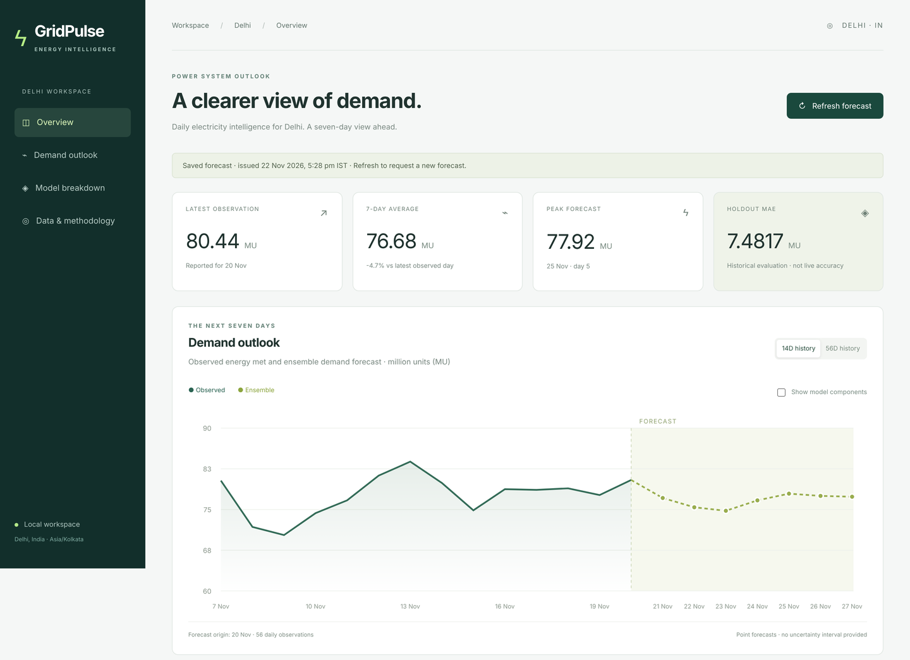
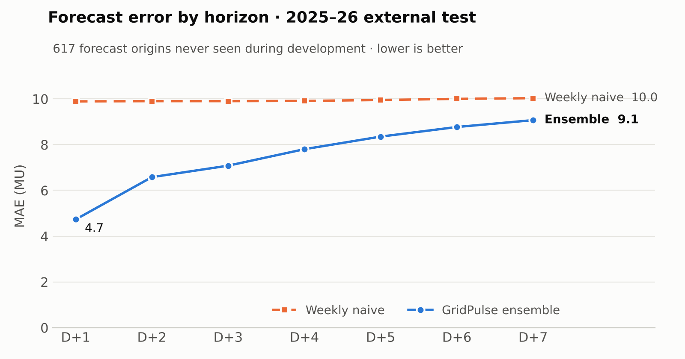
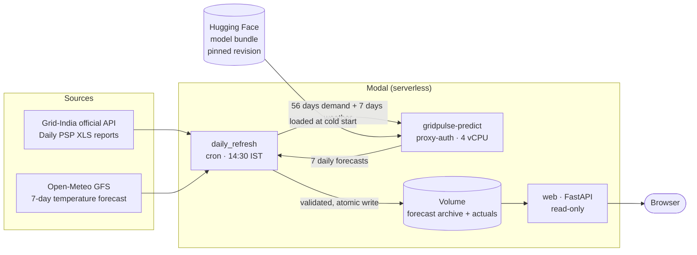
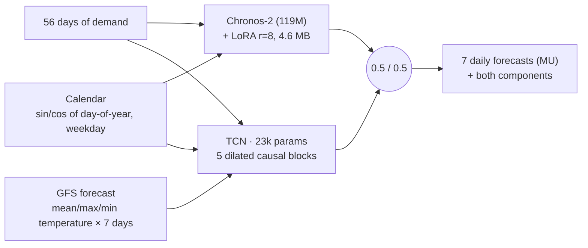

# ⚡ GridPulse

**Seven-day electricity demand forecasts for Delhi — from raw grid reports to a live, self-scoring forecast service.**

[](https://github.com/shishirgarde/gridpulse/actions/workflows/ci.yml)


[](https://shishir-garde--gridpulse-dashboard.us-east.modal.run/#overview)

**[Live dashboard →](https://shishir-garde--gridpulse-dashboard.us-east.modal.run/#overview)** · [Research notebooks](notebooks/) · [Model card](docs/model_card.md) · [Deployment](docs/deployment.md)



---

## At a glance

| | |
|---|---|
| **Task** | Forecast Delhi's daily electricity *energy met* (million units, MU) for each of the next 7 days |
| **Model** | Frozen 50/50 ensemble: **Amazon Chronos-2** with a calendar-only LoRA adapter + a 23k-parameter **Temporal Convolutional Network** that reads GFS temperature forecasts |
| **Result** | On 2025–26 data never seen during development: **MAE 7.48 MU (WAPE 7.1%)**, **25% better than a weekly-naive baseline**; day-ahead error 4.7 MU |
| **In production** | Serverless on [Modal](https://modal.com): authenticated inference API, a daily scheduled forecast at 14:30 IST, and a public dashboard that archives every forecast and scores it against what actually happened |

## Results

Every model is scored on **exactly the same forecast origins and horizons**. Ensemble weights were chosen on 2024 and frozen *before* the 2025–26 data was touched.

| Model | 2024 validation MAE | 2025–26 external MAE | External RMSE | External bias | vs weekly naive |
|---|---:|---:|---:|---:|---:|
| Weekly naive (same weekday last week) | 8.45 | 9.94 | 13.83 | +0.09 | — |
| TCN (GFS temperatures + calendar) | 7.27 | 9.02 | 11.42 | −6.33 | −9% |
| Chronos-2 LoRA (calendar only) | 6.87 | 7.72 | 11.08 | +0.61 | −22% |
| **GridPulse ensemble (50/50)** | **6.05** | **7.48** | **9.90** | −2.86 | **−25%** |

<sub>2024: 360 origins / 2,520 pairs. 2025–26: 617 origins / 4,319 pairs (Jan 2025 – Nov 2026). MU = million kWh; Delhi's daily demand ranges roughly 45–180 MU. Reproduce with `python scripts/evaluate_baselines.py`.</sub>



The two components fail in opposite directions — Chronos-2 slightly over-forecasts, the TCN under-forecasts — so averaging them cancels much of the bias and cuts RMSE by 11% relative to the better single model.

---

## Architecture

### Serving



- **Two Modal apps, least privilege.** The inference app (`deploy/modal_inference.py`) sits behind Modal proxy auth. Only the scheduled writer in the dashboard app (`deploy/modal_dashboard.py`) holds those credentials. The public web function can only read the archive. It exposes no refresh endpoint and serves a strict Content-Security-Policy.
- **Defensive inputs.** Refresh requires 56 *consecutive* days of demand that is at most 4 days old, plus exactly seven aligned weather days. Gaps are never interpolated. If any check fails the previous forecast stays live, and the job retries.
- **An honest track record.** Every forecast is archived with its issue time and inputs. The dashboard scores only forecasts issued *before* the target day began (IST), and never backfills.

### Model



- **Chronos-2 branch.** The pretrained time-series foundation model, fine-tuned with LoRA (rank 8, α 16, lr 1e-5, 200 steps) on 2019–2023 windows. It sees demand history plus calendar features only. Notebook 08 shows why it gets no weather.
- **TCN branch.** Demand history goes through five residual dilated causal convolutions (dilations 1–16, 32 channels). The 7-day future block (3 normalised GFS temperatures, 4 calendar terms, 3 availability masks) goes through a small dense encoder. A 64-unit head outputs 7 values. Training used Huber loss and AdamW, with early stopping on 2023 data.
- **Inference contract** (`src/gridpulse/inference.py`): a forecast-origin date, exactly 56 chronological daily values, and seven temperature records dated origin+1 … origin+7. The model returns per-day Chronos-2, TCN and ensemble values.

---

## How it was built — the research journey

Twelve notebooks, in the order the work happened. Each opens with its purpose and key results. Several ideas failed, and the notebooks say so: the failures are what shaped the final design.

### 1 · Understand the data — [`01`](notebooks/01_data_exploration_and_baselines.ipynb)
The first dataset was state-wise daily *energy met* for 2013–2024 from Grid-India reports, plus ERA5 weather. It needed real cleaning: duplicated dates, 7 dates with conflicting values, and 243 missing days in 96 gaps (one of them 82 days long). Only **52% of 7-day windows were usable**. Splits are strictly chronological, and windows that straddle a boundary are dropped, so no target leaks across splits. The weekly-naive baseline set the bar at roughly 8 MU MAE.

### 2 · Classical baseline — [`02`](notebooks/02_xgboost_baseline.ipynb), [`03`](notebooks/03_walk_forward_validation.ipynb)
XGBoost on 36 lag and rolling features beat naive by 27% on validation, and by 12–16% in walk-forward folds. Feature importance showed it was mostly a well-tuned persistence model (`lag_1`, `rolling_mean_7`).

### 3 · Foundation models, zero-shot — [`04`](notebooks/04_zero_shot_chronos_bolt.ipynb), [`05`](notebooks/05_zero_shot_timesfm.ipynb), [`06`](notebooks/06_foundation_models_walk_forward.ipynb)
Chronos-Bolt and TimesFM 2.5 were strong at day 1 but lost to XGBoost overall on 2022. On 2019 the ranking **flipped** (TimesFM 7.48 < Chronos 7.82 < XGBoost 8.48), and on 2021 it flipped back. **Lesson:** one validation year proves little. The project needed a stricter protocol and a longer, untouched test period.

### 4 · Reset: new data, stricter protocol — [`07`](notebooks/07_v2_data_and_distribution_shift.ipynb)
I moved to the Grid-Sentinel feed (2019–2026), cross-checked it against an official Grid-India PDF and against the first dataset (99% of overlapping days within 0.1 MU), and fixed the protocol: **train 2019–2023 → validate 2024 → external test 2025–26**. XGBoost then **lost to naive on 2024** (9.05 vs 8.45). The 2024 summer peaks (177.7 MU) were far above anything in training (153.5 MU), and tree ensembles cannot extrapolate. Adding weather to the trees made things worse.

### 5 · Fine-tuning and the weather question — [`08`](notebooks/08_chronos2_lora_finetuning.ipynb), [`09`](notebooks/09_lightgbm_with_gfs.ipynb)
- Temperature clearly drives demand: winter anomalies correlate at −0.75, about −1.5 MU per °C.
- **No look-ahead weather.** Historical forecasts come from Open-Meteo's *Previous Runs* API, so each horizon uses a GFS run that existed at the forecast origin. Observed weather is never used as a stand-in for a forecast. The leakage audit is in the notebook.
- Chronos-2 + LoRA: calendar-only **6.87** ≈ with observed weather 6.88. Feeding **GFS forecasts** as covariates broke the model (MAE ~14, bias +12 MU), because it over-reacts to forecast temperature, and the frozen base model does the same.
- A side finding: a pipeline left in training mode makes predictions depend on what else is in the batch (up to 16 MU). Every inference path now calls `.eval()`.
- LightGBM *with* GFS (8.82) beat LightGBM without it (10.67), so the forecasts carry signal. It needed a model that can use them.

### 6 · A small model for the weather signal — [`10`](notebooks/10_tcn_and_ensemble.ipynb)
A TCN trained from scratch on demand history plus GFS forecasts reached 7.27 on 2024. Its errors run opposite to Chronos-2's, and the **50/50 average reached 6.05**. The weights were frozen at that point.

### 7 · External test, packaging, deployment — [`11`](notebooks/11_external_validation_and_packaging.ipynb), [`12`](notebooks/12_live_forecasting_prototype.ipynb)
The frozen ensemble scored **7.48** on 617 unseen origins in 2025–26. The model was then packaged as `src/gridpulse`. At every hop (notebook → package → clean subprocess → Hugging Face download → live Modal endpoint → client) the forecasts matched to within **1e-5 MU**. Notebook 12 prototyped the live loop that became the dashboard.

### What didn't work (and why it mattered)

| Idea | Outcome | What it taught |
|---|---|---|
| XGBoost / LightGBM as the main model | Lost to naive on 2024 | Trees can't extrapolate to record heat-wave demand |
| Observed-weather covariates for Chronos-2 | No gain (6.88 vs 6.87) | Calendar and history already carry most of the seasonal signal |
| GFS forecasts as Chronos-2 covariates | MAE doubled | The foundation model over-reacts to temperature; route weather elsewhere |
| TimesFM-day-1 + XGBoost hybrid | −1.8% | Not worth the extra complexity |
| Single-year validation | Rankings flipped year to year | Lock a multi-year external test before choosing |

---

## Repository layout

```
gridpulse/
├── src/gridpulse/          # Installable package: inference, TCN definition, API client
├── dashboard/              # Dependency-light dashboard server + static web UI
├── deploy/                 # Modal apps: inference endpoint, dashboard + daily job
├── notebooks/              # 01–12: the full research process, in order
├── models/                 # Deployed weights: Chronos-2 LoRA adapter, TCN checkpoint,
│                           #   metadata, 2024 and 2025–26 prediction files
├── data/
│   ├── processed/          # Small, derived Delhi datasets used by the notebooks
│   └── forecasts/          # Archived live forecasts (JSON)
├── scripts/                # evaluate_baselines.py: reproduces the results table
├── tests/                  # pytest: dashboard rules, client contract, checkpoint
└── docs/                   # Deployment, dashboard, model card, images
```

## Quickstart

Requires Python 3.11 or 3.12.

```bash
git clone https://github.com/shishirgarde/gridpulse.git
cd gridpulse
python -m venv .venv && source .venv/bin/activate   # Windows: .venv\Scripts\activate
```

**Reproduce the results table** (no model download needed):

```bash
pip install -e . pandas pyarrow
python scripts/evaluate_baselines.py
```

**Run the model locally** with the committed weights (the Chronos-2 base model is downloaded from Hugging Face on first use):

```bash
pip install -e ".[inference]"
```

```python
import json, glob
from gridpulse.inference import GridPulseForecaster

model = GridPulseForecaster.from_local("models")
archive = json.load(open(sorted(glob.glob("data/forecasts/gridpulse_*.json"))[-1]))

result = model.predict(
    forecast_origin=archive["forecast_origin"],
    demand_history_mu=archive["demand_history_mu"],   # 56 daily values (MU)
    weather_forecast=archive["weather_forecast"],     # 7 × {date, mean, max, min} °C
)
for row in result["predictions"]:
    print(row["date"], round(row["ensemble_mu"], 2))
```

**Run the dashboard locally.** It serves the archived forecasts out of the box. Refresh needs Modal proxy credentials in `.env`.

```bash
pip install -e .
cp .env.example .env        # optional: add MODAL_PROXY_KEY / MODAL_PROXY_SECRET
python dashboard/dashboard.py   # → http://127.0.0.1:8050
```

**Run the tests:**

```bash
pip install -e . pytest torch
pytest
```

**Explore the notebooks:** `pip install -e ".[research]"` and then `jupyter lab`. Notebooks 01 and 07 need the raw source data; see [`data/README.md`](data/README.md).

## Deployment

Both services run on Modal; see [`docs/deployment.md`](docs/deployment.md) for the full steps.

```bash
pip install -e ".[deploy]"
modal deploy deploy/modal_inference.py     # protected inference endpoint
modal deploy deploy/modal_dashboard.py     # dashboard + daily 14:30 IST forecast
```

## Limitations

- **Energy met is not unconstrained demand.** The target is reported supply, which can sit below true demand during shortages.
- **Point forecasts only.** Neither component exposes a calibrated interval, and disagreement between the components is not a confidence band.
- **Weather is one point.** A single Delhi coordinate from GFS stands in for the city. Exact historical publication times of the GFS runs were not independently verified.
- **Overlapping evaluation.** Rolling daily origins share target days, so errors are correlated. Treat the MAE as descriptive rather than as an i.i.d. sample.
- **Historical ≠ live.** The 7.48 MU figure is a backtest. The dashboard's live track record only started in November 2026.
- This is a research prototype, not a grid-operations tool.

## Data and acknowledgements

- **Electricity:** Grid-India (formerly POSOCO) daily Power Supply Position reports, via the [Grid-Sentinel dataset](https://github.com/Deducinnamoroll/Grid-Sentinel) (2019–2026). Early experiments used the quality-controlled state-level dataset of Hunt & Bloomfield (2025), [doi:10.5281/zenodo.14983361](https://doi.org/10.5281/zenodo.14983361).
- **Weather:** [Open-Meteo](https://open-meteo.com) GFS forecasts, Previous Runs API, and the historical archive (CC BY 4.0).
- **Models:** [Amazon Chronos-2](https://huggingface.co/amazon/chronos-2) and [Google TimesFM](https://github.com/google-research/timesfm), both Apache-2.0.

Raw source files are not redistributed here; [`data/README.md`](data/README.md) explains how to fetch them.

## License

[Apache-2.0](LICENSE)
